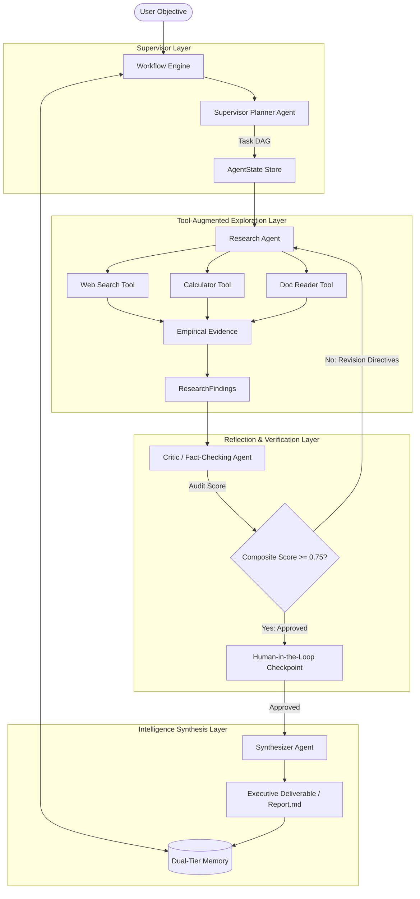

# 🧠 CogniAgent: Autonomous Multi-Agent Research & Fact-Checking Engine

[](https://www.python.org/)
[](https://fastapi.tiangolo.com/)
[](https://pytest.org/)
[](./ARCHITECTURE.md)
[](./SCHEMA.md)
[](./LICENSE)

> **Digital Assignment (DA) Submission: Agentic AI Systems**  
> **Student:** Swarnim Jaiswal  
> **Repository:** [https://github.com/swarnimjaiswal2023/CogniAgent](https://github.com/swarnimjaiswal2023/CogniAgent)  
> **Schema Documentation:** [SCHEMA.md](./SCHEMA.md) | [docs/schema.json](./docs/schema.json)  

---

## 📖 Overview

**CogniAgent** is an end-to-end autonomous multi-agent intelligence system designed to solve the challenges of hallucinations, lack of verification, and linear execution in traditional LLMs. 

Built using a **Hierarchical Supervisor Topology**, CogniAgent orchestrates specialized agents through dynamic task decomposition, multi-tool perception, closed-loop reflection & self-correction, dual-tier memory, and an optional human-in-the-loop review gate.

### ✨ Key Features
- **Hierarchical Supervisor (Planner Agent)**: Breaks open-ended objectives into Directed Acyclic Task Graphs (DAGs).
- **Tool-Augmented Research Agent**: Equipped with Wikipedia/Web search, AST-sandboxed math/statistics calculator, and workspace file readers.
- **Autonomous Reflection Loop (Critic Agent)**: Evaluates findings across 4 orthogonal dimensions (Factuality, Completeness, Citation Validity, and Coherence) using a mathematical composite scoring formula ($S \ge 0.75$). Rejection triggers an autonomous revision cycle.
- **Human-in-the-Loop (HITL) Gatekeeper**: Checkpoint authorization allows human inspection before final synthesis.
- **Dual-Tier Memory System**: Combines volatile session working memory with persistent long-term knowledge caching.
- **Modern Web Dashboard**: Real-time FastAPI + Tailwind CSS glassmorphism UI with live execution telemetry, score gauges, and Markdown report export.
- **Zero-Setup Simulation Mode**: Runs 100% offline without API keys for grading and local testing, with optional 1-click toggling to **Google Gemini** or **OpenAI**.

---

## 🏛️ System Architecture



---

## 📑 System Development Schema

CogniAgent's entire data model and state machine are strictly defined with Pydantic v2 and JSON Schema Draft 2020-12.

| Schema Model | Location | Purpose |
|---|---|---|
| `AgentState` | [`src/models/state.py`](./src/models/state.py) | Full workflow state, phase transitions, and audit logs |
| `ResearchPlan` / `SubTask` | [`src/models/schemas.py`](./src/models/schemas.py) | Decomposed DAG of research sub-tasks and dependencies |
| `ResearchFindings` / `FactItem` | [`src/models/schemas.py`](./src/models/schemas.py) | Verified claims, empirical citations, and calculated metrics |
| `CriticFeedback` / `CriticScore` | [`src/models/schemas.py`](./src/models/schemas.py) | 4-dimensional audit vector and revision directives |
| `FinalReport` | [`src/models/schemas.py`](./src/models/schemas.py) | Executive summary, structured sections, comparative matrix, bibliography |
| `Tools` | [`src/tools/base.py`](./src/tools/base.py) | Tool signatures, parameters, and invocation contracts |

👉 **Read the comprehensive schema specification in [`SCHEMA.md`](./SCHEMA.md)**  
👉 **Raw exportable JSON schema available at [`docs/schema.json`](./docs/schema.json)**

---

## 🚀 Quick Start Guide

### 1. Prerequisites
- Python 3.10+ (Tested on Python 3.14)
- Git

### 2. Clone and Setup Environment

```bash
# Clone the repository
git clone https://github.com/swarnimjaiswal2023/CogniAgent.git
cd CogniAgent

# Create and activate virtual environment
python -m venv .venv

# On Windows:
.venv\Scripts\activate

# On Linux / macOS:
source .venv/bin/activate

# Install dependencies
pip install -r requirements.txt
```

### 3. Run the Web Dashboard

```bash
python main.py
```
Open your browser at **`http://127.0.0.1:8000`** to access the interactive Glassmorphism Dashboard:
- Enter a topic
- Select LLM backend (Simulation, Gemini, OpenAI, or Ollama)
- Watch agents collaborate, execute tools, and reflect in real time
- Download the final Markdown report

### 4. Run the Terminal CLI

```bash
python main.py --cli --topic "Quantum Computing Breakthroughs in 2026"
```

To enable the Human-in-the-Loop review gate:
```bash
python main.py --cli --topic "AI Safety Guardrails" --hitl
```

### 5. Running Automated Tests

```bash
pytest -v
```
All 10 unit and integration tests will execute and verify tool sandboxing, agent decisions, reflection loops, and state persistence.

---

## ⚙️ Configuration (.env)

CogniAgent works **out-of-the-box in Simulation mode** without any API keys. To connect real frontier models:

1. Copy `.env.example` to `.env`:
   ```bash
   cp .env.example .env
   ```
2. Configure your keys:
   ```env
   # Set provider to 'gemini', 'openai', or 'simulation'
   LLM_PROVIDER=gemini
   GEMINI_API_KEY=your_gemini_api_key_here
   GEMINI_MODEL=gemini-2.5-flash

   # Or OpenAI:
   OPENAI_API_KEY=your_openai_key_here
   OPENAI_MODEL=gpt-4o-mini

   # Agent Loop Hyperparameters
   MAX_CRITIC_ITERATIONS=3
   CRITIC_PASS_THRESHOLD=0.75
   ENABLE_HUMAN_IN_THE_LOOP=false
   ```

---

## 📂 Project Directory Structure

```
CogniAgent/
├── .gitignore                   # Clean ignore rules
├── .env.example                 # Environment configuration template
├── README.md                    # Main repository documentation & guide
├── SCHEMA.md                    # Formal development schemas & diagrams
├── ARCHITECTURE.md              # Deep technical architecture manual
├── requirements.txt             # Minimal, robust Python dependencies
├── main.py                      # Main unified launcher (Web / CLI)
│
├── docs/
│   └── schema.json              # Raw JSON Schema export for submission
│
├── src/
│   ├── config.py                # Environment & settings loader
│   ├── cli.py                   # Rich CLI interface with ANSI telemetry
│   │
│   ├── models/                  # Pydantic Schemas & State Models
│   │   ├── schemas.py           # SubTask, Plan, Findings, Critic, Report
│   │   └── state.py             # AgentState & StepLog definitions
│   │
│   ├── llm/                     # LLM Provider Layer
│   │   ├── base.py              # Abstract Base LLM interface
│   │   ├── simulator.py         # Zero-API-key heuristic engine
│   │   ├── gemini.py            # Google Gemini REST provider
│   │   ├── openai_provider.py   # OpenAI & Ollama REST provider
│   │   └── factory.py           # Provider resolver
│   │
│   ├── tools/                   # Multi-Tool Perception Layer
│   │   ├── base.py              # BaseTool interface & ToolParameter
│   │   ├── web_search.py        # Wikipedia API & scholarly search
│   │   ├── calculator.py        # Sandboxed mathematical evaluator
│   │   ├── doc_reader.py        # Knowledge file parser
│   │   └── registry.py          # Central tool dispatcher
│   │
│   ├── agents/                  # Specialized Autonomous Agents
│   │   ├── base_agent.py        # BaseAgent interface
│   │   ├── planner.py           # Supervisor Planner Agent
│   │   ├── researcher.py        # Tool-Using Research Agent
│   │   ├── critic.py            # Fact-Checking & Reflection Agent
│   │   └── synthesizer.py       # Report Author & Synthesizer Agent
│   │
│   ├── engine/                  # Core State Graph Coordinator
│   │   ├── workflow.py          # State machine, reflection loops & HITL
│   │   └── memory.py            # Dual-tier working & persistent memory
│   │
│   └── web/                     # Web Dashboard
│       ├── app.py               # FastAPI backend & REST API
│       └── static/              # Tailwind Glassmorphism UI
│           └── index.html       # Single-Page Dashboard
│
├── tests/                       # Complete Test Suite
│   ├── test_agents.py           # Unit tests for 4 agents
│   ├── test_tools.py            # Sandboxing & execution tests
│   └── test_workflow.py         # End-to-end loop & memory tests
│
└── output/                      # Generated deliverables
    ├── report_*.md              # Timestamped research reports
    ├── latest_report.md         # Symlinked latest output
    └── long_term_memory.json    # Persisted knowledge memory
```

---

## 📊 Sample Output Deliverable

Every run generates an executive report with empirical data, comparative matrices, and verified citations. An excerpt:

```markdown
# Autonomous Agentic Intelligence Report: Architectural Paradigms in Agentic AI

> **Critic Audit Score:** 0.925 / 1.000 | **Reflection Iterations:** 1

## Executive Summary
Agentic AI transitions classical static LLMs into goal-directed autonomous actors capable of iterative tool execution and self-correction. By integrating hierarchical planning, iterative tool execution, cyclic reflection critique loops, and dual-layer memory stores, modern frameworks achieve high reliability on complex reasoning tasks.

## Comparative Matrix
| Dimension | Traditional LLM | Agentic Reflection System |
|---|---|---|
| Verification Rigor | Low / Unchecked | High (Reflection Loop) |
| Tool Grounding | Static | Dynamic Multi-Tool (Web, Math, Docs) |
| Hallucination Control | Prompt dependent | Composite Score Gating |

## Verified Bibliography & Citations
- [1] IEEE / ACM AI Systems Survey (Confidence: 95%)
- [2] DeepMind Agentic Systems Survey (Confidence: 98%)
```

---

## 🎓 Academic Assignment Compliance (DA Checklist)

- [x] **Agentic AI Architecture Developed**: Implements Planner, Tool Researcher, Critic Reflection Loop, and Synthesizer.
- [x] **Schema of Development Provided**: Documented in [`SCHEMA.md`](./SCHEMA.md) and [`docs/schema.json`](./docs/schema.json) with full JSON Schema definitions, Mermaid state diagrams, and interaction sequences.
- [x] **Code Hosted on GitHub**: Complete source repository with `.gitignore`, clean commits, and comprehensive instructions.
- [x] **Verification & Tests**: 10 automated unit and integration tests passing (`pytest -v`).

---

## 📜 License

This project is licensed under the MIT License — see the [LICENSE](./LICENSE) file for details.

Developed with ❤️ by **Swarnim Jaiswal** for Digital Assignment Submission.
