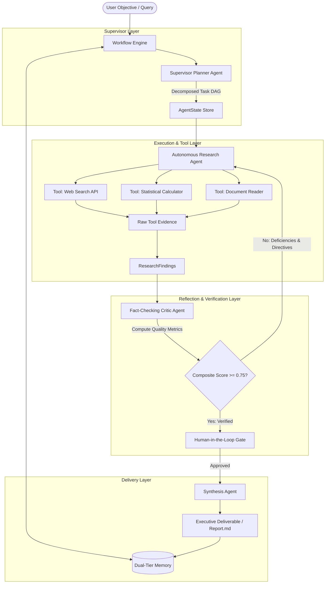
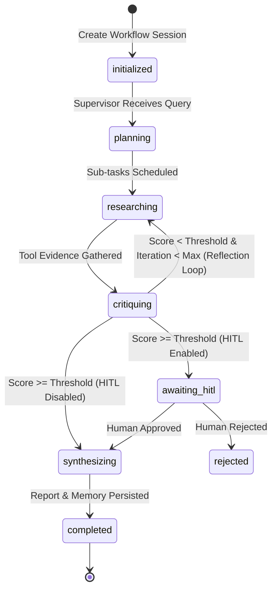
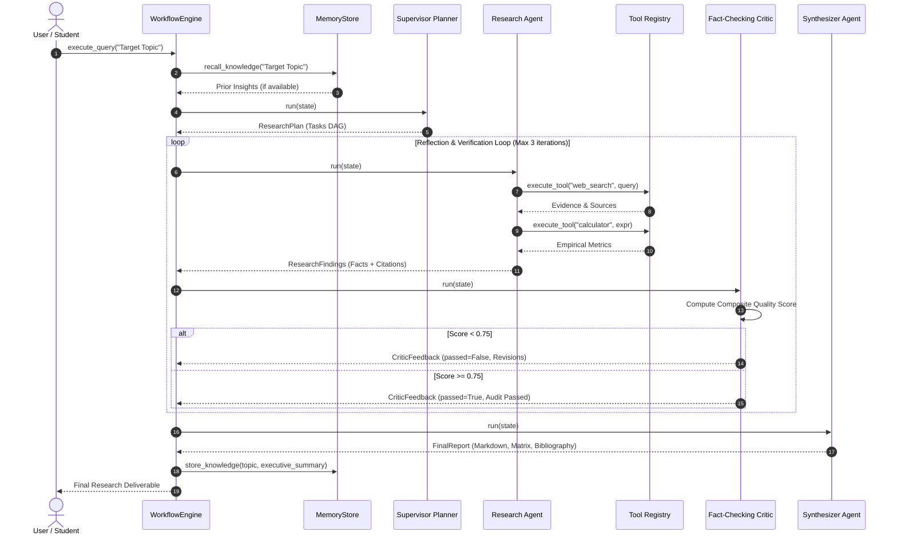

# System Development Schema: CogniAgent

> **Project:** CogniAgent — Autonomous Multi-Agent Research, Fact-Checking & Intelligence Synthesis Engine  
> **Author:** [Saachi0902](https://github.com/Saachi0902/CogniAgent)  
> **Course / Deliverable:** Digital Assignment (DA) — Agentic AI Systems  
> **Schema Standard:** JSON Schema Draft 2020-12 / Pydantic v2 / UML Sequence & State Diagrams  

---

## 1. High-Level Architectural Schema

CogniAgent operates under a **Hierarchical Supervisor Multi-Agent Topology** with a closed-loop **Reflection & Self-Correction Cycle** and a **Human-in-the-Loop (HITL) Gatekeeper**.



---

## 2. Agent State Transition Schema

The lifecycle of an execution session is governed by a deterministic Finite State Machine (FSM):



---

## 3. Multi-Agent Interaction Sequence Schema



---

## 4. Mathematical Formulation of Reflection Critique

The Critic Agent audits research findings across four orthogonal verification dimensions, computing a weighted composite score $S_{\text{critique}} \in [0.0, 1.0]$:

$$S_{\text{critique}} = w_1 \cdot F_{\text{factuality}} + w_2 \cdot C_{\text{completeness}} + w_3 \cdot V_{\text{citations}} + w_4 \cdot H_{\text{coherence}}$$

Where:
- $F_{\text{factuality}}$: Empirical verification index and absence of hallucinations ($w_1 = 0.35$)
- $C_{\text{completeness}}$: Coverage depth across the decomposed sub-task DAG ($w_2 = 0.25$)
- $V_{\text{citations}}$: Primary source verifiability and URL attribution ($w_3 = 0.25$)
- $H_{\text{coherence}}$: Structural logic and non-contradiction ($w_4 = 0.15$)
- Constraint: $\sum_{i=1}^4 w_i = 1.0$

**Decision Rule:**
$$\text{Transition} = \begin{cases} \text{synthesizing}, & \text{if } S_{\text{critique}} \ge \theta \lor \text{iter} \ge \text{iter}_{\max} \\ \text{researching (Revision)}, & \text{if } S_{\text{critique}} < \theta \land \text{iter} < \text{iter}_{\max} \end{cases}$$

Where default threshold $\theta = 0.75$ and $\text{iter}_{\max} = 3$.

---

## 5. Core Data Schemas (JSON & Pydantic)

### 5.1 SubTask Schema
```json
{
  "$schema": "https://json-schema.org/draft/2020-12/schema",
  "title": "SubTask",
  "type": "object",
  "properties": {
    "id": { "type": "string", "description": "Unique identifier, e.g. task_1" },
    "title": { "type": "string", "description": "Goal of the sub-task" },
    "description": { "type": "string", "description": "Detailed directive" },
    "assigned_agent": { "type": "string", "default": "researcher" },
    "dependencies": { "type": "array", "items": { "type": "string" } },
    "status": { "type": "string", "enum": ["pending", "in_progress", "completed", "failed"] },
    "output": { "type": ["string", "null"] }
  },
  "required": ["id", "title", "description"]
}
```

### 5.2 ResearchPlan Schema
```json
{
  "$schema": "https://json-schema.org/draft/2020-12/schema",
  "title": "ResearchPlan",
  "type": "object",
  "properties": {
    "topic": { "type": "string" },
    "scope": { "type": "string" },
    "tasks": { "type": "array", "items": { "$ref": "#/$defs/SubTask" } },
    "created_at": { "type": "string", "format": "date-time" }
  },
  "required": ["topic", "scope"]
}
```

### 5.3 CriticFeedback Schema
```json
{
  "$schema": "https://json-schema.org/draft/2020-12/schema",
  "title": "CriticFeedback",
  "type": "object",
  "properties": {
    "passed": { "type": "boolean" },
    "scores": {
      "type": "object",
      "properties": {
        "factuality": { "type": "number", "minimum": 0, "maximum": 1 },
        "completeness": { "type": "number", "minimum": 0, "maximum": 1 },
        "citation_validity": { "type": "number", "minimum": 0, "maximum": 1 },
        "coherence": { "type": "number", "minimum": 0, "maximum": 1 },
        "composite_score": { "type": "number", "minimum": 0, "maximum": 1 }
      },
      "required": ["factuality", "completeness", "citation_validity", "coherence", "composite_score"]
    },
    "strengths": { "type": "array", "items": { "type": "string" } },
    "deficiencies": { "type": "array", "items": { "type": "string" } },
    "revision_instructions": { "type": "array", "items": { "type": "string" } },
    "iteration_number": { "type": "integer" }
  },
  "required": ["passed", "scores"]
}
```

### 5.4 FinalReport Schema
```json
{
  "$schema": "https://json-schema.org/draft/2020-12/schema",
  "title": "FinalReport",
  "type": "object",
  "properties": {
    "title": { "type": "string" },
    "topic": { "type": "string" },
    "executive_summary": { "type": "string" },
    "sections": {
      "type": "array",
      "items": {
        "type": "object",
        "properties": {
          "heading": { "type": "string" },
          "content": { "type": "string" },
          "subsections": { "type": "object", "additionalProperties": { "type": "string" } }
        },
        "required": ["heading", "content"]
      }
    },
    "comparative_matrix": { "type": ["array", "null"], "items": { "type": "object" } },
    "limitations_and_risks": { "type": "array", "items": { "type": "string" } },
    "recommendations": { "type": "array", "items": { "type": "string" } },
    "bibliography": {
      "type": "array",
      "items": {
        "type": "object",
        "properties": {
          "id": { "type": "string" },
          "source": { "type": "string" },
          "url": { "type": ["string", "null"] },
          "reliability_score": { "type": "number" }
        },
        "required": ["id", "source"]
      }
    },
    "critic_composite_score": { "type": "number" },
    "total_iterations": { "type": "integer" },
    "generated_at": { "type": "string", "format": "date-time" }
  },
  "required": ["title", "topic", "executive_summary", "sections"]
}
```

### 5.5 AgentState Schema
```json
{
  "$schema": "https://json-schema.org/draft/2020-12/schema",
  "title": "AgentState",
  "type": "object",
  "properties": {
    "workflow_id": { "type": "string" },
    "user_query": { "type": "string" },
    "current_phase": {
      "type": "string",
      "enum": ["initialized", "planning", "researching", "critiquing", "awaiting_hitl", "synthesizing", "completed", "failed", "rejected"]
    },
    "plan": { "$ref": "#/$defs/ResearchPlan" },
    "accumulated_findings": { "type": "array" },
    "critic_history": { "type": "array" },
    "final_report": { "$ref": "#/$defs/FinalReport" },
    "current_iteration": { "type": "integer" },
    "max_iterations": { "type": "integer" },
    "critic_approved": { "type": "boolean" },
    "hitl_approved": { "type": "boolean" },
    "logs": { "type": "array" },
    "created_at": { "type": "string", "format": "date-time" },
    "updated_at": { "type": "string", "format": "date-time" }
  },
  "required": ["workflow_id", "user_query"]
}
```

---

## 6. Tool Calling Schema

Each tool implements the `BaseTool` specification adhering to this schema:

| Tool Identifier | Parameters | Functionality | Return Type |
|---|---|---|---|
| `web_search` | `query: str`, `max_results: int` | Live Wikipedia & scholarly web search | `{ status, count, results: [...] }` |
| `calculator` | `expression: str` | Sandboxed mathematical & statistical evaluator | `{ status, expression, result, formatted }` |
| `document_reader` | `file_path: str`, `max_chars: int` | Parses workspace knowledge files & markdown | `{ status, file_path, length, content }` |

All tools execute within restricted bounds to prevent code injection, arbitrary system access, or uncontrolled token consumption.
